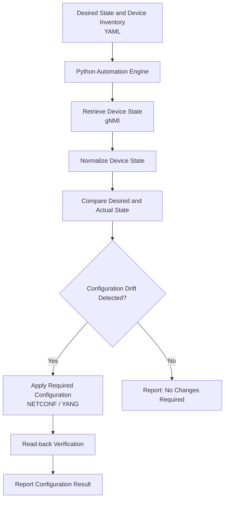
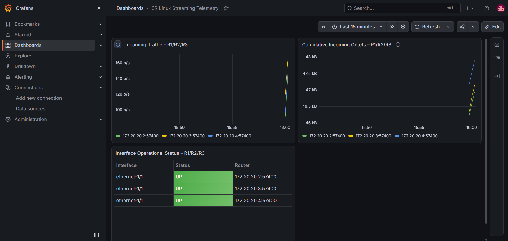

# Network Automation & Programmability Platform

[](https://github.com/kapiliyer10/network-automation-platform/actions/workflows/ci.yml)

A Python-based network automation platform for Nokia SR Linux, developed and tested in a three-router Containerlab environment.

The platform automates device-state discovery, comparison against YAML-based desired configurations, configuration drift detection, and network configuration management. It uses gNMI to retrieve device state and NETCONF/YANG as the primary model-driven configuration mechanism. FastAPI provides REST API access, Ansible supports orchestration, and a separate telemetry pipeline uses gNMIc, Prometheus, and Grafana for network monitoring.

## 1. Project Overview

The platform follows a desired-state approach: it retrieves actual device state and compares it against the intended configuration. Detected discrepancies can be reconciled through configuration changes, followed by read-back verification.

### Core Automation Workflow


## 2. Key Features

### Network State Discovery and Drift Detection

- **Device inventory and endpoint discovery:** Loads YAML-based device inventory and resolves runtime device endpoints.
- **gNMI state discovery:** Retrieves device state and normalizes device-specific responses into an application model.
- **Desired-state management:** Maintains intended network configurations in YAML.
- **Configuration drift detection:** Compares desired and actual device state to identify and report discrepancies.

### Configuration Management and Routing

- **NETCONF/YANG configuration:** Supports model-driven configuration deployment and configuration read-back verification.
- **Jinja2 configuration generation:** Renders Nokia SR Linux CLI configuration through a separate configuration-generation path.
- **Routing protocol configuration:** Supports OSPF and BGP configuration management. The three-router lab runs OSPF and an eBGP full mesh; all six BGP peer sessions and route exchange have been verified through the SR Linux CLI.

  **Current limitation:** The Python application does not yet automate operational BGP peer-state or route-table validation.

### API, Orchestration and CI/CD

- **REST API:** Exposes network automation workflows through FastAPI.
- **Automation orchestration:** Integrates Ansible to invoke automation workflows.
- **Containerization:** Uses Docker to package the application.
- **Automated testing and CI/CD:** Uses pytest and GitHub Actions to execute automated tests and validate changes.

### Streaming Telemetry and Observability

- **Telemetry collection:** Uses gNMIc and OpenConfig to collect SR Linux interface telemetry.
- **Metrics monitoring:** Uses Prometheus to collect and store telemetry metrics.
- **Visualization:** Uses Grafana dashboards to monitor interface counters and operational status.

## 3. Architecture

The platform separates its core automation workflow, management interfaces, and monitoring infrastructure.

- **Core automation:** The Python engine processes desired state, retrieves device state through gNMI, detects configuration drift, and manages configuration reconciliation.
- **Management interfaces:** FastAPI exposes the automation workflow through REST endpoints, while Ansible provides orchestration.
- **Configuration methods:** NETCONF/YANG is the primary mechanism for live model-driven configuration. Jinja2 provides a separate CLI configuration-rendering path.
- **Monitoring pipeline:** gNMIc collects streaming telemetry, Prometheus stores metrics, and Grafana provides visualization. This pipeline operates separately from the configuration workflow.

For detailed component diagrams and implementation flows, see [System Architecture](docs/architecture.md) and [Streaming Telemetry and Monitoring](docs/streaming-telemetry.md).

## 4. Network Lab

The platform is developed and tested on a three-router Nokia SR Linux topology deployed using Containerlab.

### Network Topology

The primary and expanded Containerlab profiles, including router links, loopbacks, management addressing, and Linux endpoint connections, are documented in [Network Topology](docs/network-topology.md).

### Routing and Management

- **OSPF:** Provides internal routing across the three-router topology.
- **eBGP:** A full-mesh peering arrangement runs across AS 65001–65003. All six BGP peer sessions and route exchange have been verified through the SR Linux CLI.
- **Management:** gNMI and NETCONF provide device access for state retrieval and configuration management.

The Containerlab topology is defined in `topology/srl-lab.clab.yml`, with router startup configurations maintained under `configs/srl/`.

### Related Network Test and Validation Project

A separate project, `network-test-validation-platform`, uses an expanded lab profile named `srl-expanded`. It retains the three SR Linux routers and adds Linux endpoints H1 and H2 for end-to-end traffic testing.

The responsibilities are separated:
- `network-automation-platform`: Network automation, device management, and configuration workflows.
- `network-test-validation-platform`: Network behavior testing and end-to-end validation.

See [Network Topology](docs/network-topology.md) for details about both lab profiles.

## 5. Technology Stack

| Category | Technologies |
|---|---|
| Programming and Development | Python 3.12, Linux, YAML, Git |
| Network Infrastructure | Nokia SR Linux, Containerlab, Docker, IPv4 |
| Routing Protocols | OSPF, BGP |
| Network Programmability | gNMI, NETCONF, YANG, OpenConfig |
| Configuration and Orchestration | Jinja2, Ansible |
| API Development | FastAPI, REST API, Uvicorn |
| Monitoring and Observability | gNMIc, Prometheus, Grafana |
| Testing and CI/CD | pytest, GitHub Actions |

## 6. Repository Structure

The repository is organized into application modules, network configuration, automation workflows, and supporting infrastructure.

```text
.
├── .github/workflows/       # GitHub Actions CI pipeline
├── ansible/                 # Ansible playbooks and inventory
├── configs/
│   ├── desired/             # Desired network configurations
│   ├── inventory/           # Network device inventory
│   └── srl/                 # Nokia SR Linux startup configurations
├── docs/                    # Architecture and technical documentation
├── generated/               # Generated CLI configuration files
├── scripts/                 # Lab lifecycle and automation scripts
├── src/
│   ├── api/                 # FastAPI application
│   ├── config/              # Configuration rendering and NETCONF handling
│   ├── desired/             # Desired-state loading and comparison
│   ├── inventory/           # Device inventory handling
│   ├── network/             # gNMI, NETCONF and device-state operations
│   ├── reporting.py         # Automation result reporting
│   └── workflow.py          # Core automation workflow
├── templates/               # Jinja2 configuration templates
├── telemetry/               # gNMIc and Prometheus configuration
├── tests/                   # Unit, application and integration tests
├── topology/                # Containerlab topology definitions
├── Dockerfile
├── requirements.txt
└── README.md
```

## 7. Getting Started

Follow these steps to set up the application, deploy the network lab, and run the automation platform locally.

### Prerequisites

- Linux environment
- Python 3.12
- Docker with the Docker daemon running
- Containerlab
- Git

### 1. Clone the Repository and Install Dependencies

```bash
git clone https://github.com/kapiliyer10/network-automation-platform.git
cd network-automation-platform

python3.12 -m venv .venv
source .venv/bin/activate
pip install -r requirements.txt
```

### 2. Configure Credentials

Create your local environment file:

```bash
cp .env.example .env
```

Populate `.env` with the required credentials for your environment. Keep credentials and other secrets out of version control; do not commit `.env`.

### 3. Deploy the Network Lab

Start the three-router Nokia SR Linux topology and wait for OSPF convergence:

```bash
./scripts/lab_up.sh
./scripts/wait_for_ospf.sh
```

### 4. Run the Automated Tests

With the lab running and the virtual environment activated, execute the test suite:

```bash
pytest -q
```

### 5. Start the REST API

Start the FastAPI application:

```bash
uvicorn src.api.main:app --host 0.0.0.0 --port 8000
```

Once the service is running, access the interactive API documentation at:

`http://127.0.0.1:8000/docs`

Keep the API process running while using the endpoints. Stop it with `Ctrl+C` when finished.

### 6. Stop the Network Lab

After completing your work, shut down the Containerlab environment:

```bash
./scripts/lab_down.sh
```

## 8. API Reference

The platform exposes network automation operations through FastAPI. Endpoint definitions, request examples, and configuration behavior are documented in the [FastAPI Reference](docs/fastapi-reference.md).

## 9. Testing and CI/CD

The project uses pytest for application-level and live Containerlab integration tests. GitHub Actions runs compile checks, both test groups, the application image build, lab cleanup, and JUnit result upload. For test commands, coverage, recorded results, and workflow details, see [Testing and CI/CD](docs/testing-and-ci-cd.md).

## 10. Project Status

The core automation workflow and streaming telemetry extension have been implemented and verified in the primary three-router Nokia SR Linux lab.

### Implemented and Verified

- **Network automation:** Device-state discovery, desired-state comparison, drift detection, NETCONF configuration, and read-back verification.
- **Network environment:** Three-router OSPF topology and eBGP full-mesh connectivity. All six BGP peer sessions reached Established, and route exchange was verified through the SR Linux CLI.
- **Application integration:** FastAPI, Ansible, and Docker integration.
- **Testing and CI/CD:** Automated pytest suites and GitHub Actions pipeline.
- **Monitoring:** Streaming telemetry using gNMIc and OpenConfig, with Prometheus metrics and Grafana dashboards for interface counters and operational status.

### Scope and Limitations

The RESTCONF demonstration remains deferred and is not part of the completed core workflow. BGP operational peer-state and route-table validation limitations are documented under [Key Features](#2-key-features).

### Telemetry Dashboard

The following dashboard shows the streaming telemetry monitoring implemented for the three-router lab.



### Technical Documentation

The following documents provide additional implementation details:

| Area | Documentation |
|---|---|
| Architecture | [System Architecture](docs/architecture.md) |
| Network Design | [Network Topology](docs/network-topology.md) |
| Routing | [OSPF and BGP](docs/routing-protocols.md) |
| Configuration Management | [Desired State and Drift Detection](docs/desired-state-and-drift.md) |
| Network Programmability | [gNMI, NETCONF and YANG](docs/gnmi-netconf-and-yang.md) |
| Configuration and Orchestration | [Jinja2 and Ansible](docs/configuration-and-ansible.md) |
| API Development | [FastAPI Reference](docs/fastapi-reference.md) |
| Monitoring | [Streaming Telemetry and Monitoring](docs/streaming-telemetry.md) |
| Quality Assurance | [Testing and CI/CD](docs/testing-and-ci-cd.md) |
| Development Progress | [Project Milestones](docs/milestones.md) |
