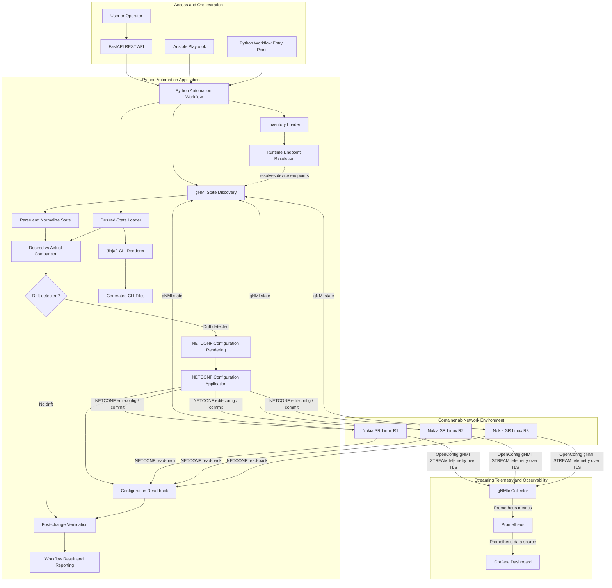

# System Architecture

## 1. Overview

The Network Automation & Programmability Platform is a Python application that implements a closed-loop network automation workflow for Nokia SR Linux. It retrieves operational state, normalizes device data, compares actual state with YAML-based desired state, identifies drift, applies configuration through the model-driven NETCONF path, and verifies the result.

FastAPI and Ansible are two ways to invoke or orchestrate the Python workflow. They are interfaces around the automation logic, not sequential stages in the device-configuration process.

## 2. High-Level Architecture



The diagram shows the logical responsibilities and management paths. The three routers are devices in the Containerlab environment; the workflow addresses them through inventory and runtime endpoint resolution.

## 3. Main Components

| Component | Responsibility |
|---|---|
| FastAPI | Exposes device and workflow operations through REST endpoints |
| Ansible | Invokes and orchestrates the existing Python workflow |
| Python workflow | Coordinates inventory, discovery, comparison, configuration, verification, and reporting |
| Inventory loader | Loads logical device information from YAML |
| Endpoint resolver | Resolves current management endpoints from the running environment |
| gNMI client | Retrieves operational device state |
| State normalization | Converts device-specific responses into a consistent application model |
| Desired-state loader | Loads and validates intended configuration from YAML |
| Comparator | Compares desired and actual state |
| NETCONF renderer and applier | Builds and applies model-driven configuration |
| Jinja2 renderer | Generates SR Linux CLI configuration files as a separate rendering path |
| Reporting | Summarizes validation and drift results |
| gNMIc collector | Subscribes to SR Linux OpenConfig telemetry and exposes Prometheus metrics |
| Prometheus | Scrapes, stores, and makes telemetry metrics available for queries |
| Grafana | Queries Prometheus and visualizes interface traffic and operational status |

## 4. Normalized Internal Data Model

The normalization layer separates device-specific gNMI/YANG responses from application logic. The high-level data path is:

```text
SR Linux Device
      |
      v
   gNMI / YANG
      |
      v
Device-specific response
      |
      v
 Parser / Adapter
      |
      v
Normalized Application Model
      |
      +----> Desired-state comparison
      +----> Drift detection
      +----> Reporting
      +----> API response
```

Examples of normalized fields include interface name, administrative state, operational state, IPv4 address, route attributes, and OSPF neighbor information. The normalized model allows comparison and reporting code to work with stable application structures rather than raw device responses.

## 5. Configuration Paths

The project has two configuration-generation paths. They should be understood separately.

### Jinja2 CLI rendering

```text
Desired Configuration
        |
        v
Jinja2 Template
        |
        v
Generated SR Linux CLI File
```

The Jinja2 path renders CLI configuration under the generated output directory. It is a configuration-rendering capability and is distinct from the primary live NETCONF workflow.

### NETCONF / YANG configuration

```text
Desired Configuration
        |
        v
NETCONF Configuration Rendering
        |
        v
NETCONF edit-config / commit
        |
        v
SR Linux Device
        |
        v
Configuration Read-back
        |
        v
Verification
```

NETCONF is the primary model-driven configuration mechanism in the live closed-loop workflow. Configuration application is followed by read-back and validation.

## 6. Runtime, Lab, and CI Separation

- **Containerlab** provides the primary three-router SR Linux environment.
- **Docker** packages the Python automation application. The application container and the Containerlab devices have separate responsibilities.
- **GitHub Actions** provisions the lab for CI, waits for OSPF readiness, runs tests, builds the application image, stops the lab, and uploads test-result artifacts.

The expanded topology with Linux endpoints belongs to the Project 2 validation environment. See [Network Topology](network-topology.md).

## 7. Routing Configuration Scope

The primary lab uses OSPF for routing and CI readiness. The Project 1 implementation also includes BGP desired-state and NETCONF configuration support. This documents the implemented configuration capability; it does not imply that BGP operational session state is part of the normalized gNMI discovery model.

## 8. Streaming Telemetry and Monitoring

The project includes a separate streaming telemetry and observability pipeline. This pipeline monitors the three routers in the primary Containerlab topology. It operates independently of the Python closed-loop automation workflow described in the preceding sections.

### Monitoring data flow

```text
Nokia SR Linux R1, R2, R3
          |
          | OpenConfig gNMI STREAM / SAMPLE
          | Secure gNMI endpoint (TCP 57400)
          v
     gNMIc Collector
          |
          | Prometheus metrics
          | HTTP endpoint :9804/metrics
          v
       Prometheus
          |
          | Prometheus data source
          v
        Grafana
          |
          v
   SR Linux Streaming Telemetry Dashboard
```

### Component responsibilities

| Component | Responsibility |
|---|---|
| gNMIc | Connects to the three SR Linux routers, subscribes to configured OpenConfig paths, and exports metrics |
| Prometheus | Scrapes the gNMIc metrics endpoint and stores time-series data |
| Grafana | Uses Prometheus as its data source to display telemetry dashboards |

The monitoring configuration is kept separately from the Python application configuration:

- `telemetry/gnmic.yaml` defines the gNMI targets, TLS CA, subscriptions, sampling interval, and Prometheus output.
- `telemetry/prometheus.yml` defines the Prometheus scrape configuration.

### Verified telemetry scope

The implemented subscriptions use the OpenConfig model and monitor `ethernet-1/1` on each router. The two verified telemetry paths are:

- Interface incoming octets: `openconfig:/interfaces/interface[name=ethernet-1/1]/state/counters/in-octets`
- Interface operational status: `openconfig:/interfaces/interface[name=ethernet-1/1]/state/oper-status`

gNMIc uses STREAM subscriptions with SAMPLE mode and a five-second sample interval. The connections use the secure gNMI endpoint on TCP port `57400`, with CA certificate validation and credentials supplied through environment variables.

Prometheus scrapes the gNMIc exporter every 15 seconds. Grafana uses Prometheus as its data source.

### Grafana dashboard

The `SR Linux Streaming Telemetry` dashboard contains three panels:

1. **Incoming Traffic** — displays incoming traffic rates for R1, R2, and R3 using the rate of change of the incoming-octet counters.
2. **Cumulative Incoming Octets** — displays the cumulative incoming-octet counters for the three routers.
3. **Interface Operational Status** — displays the operational status of `ethernet-1/1` on each router.

### Separation from the automation workflow

Streaming telemetry is an observability capability. It provides continuously collected operational measurements for monitoring and visualization.

It does not replace or modify the Python gNMI discovery client, desired-state comparison, drift detection, NETCONF configuration workflow, or post-change verification. The two paths use gNMI for different purposes:

- **Python automation workflow:** retrieves device state for application-level discovery and closed-loop configuration.
- **gNMIc monitoring pipeline:** subscribes to periodic OpenConfig updates and exports metrics for Prometheus and Grafana.

Only the listed telemetry paths have been verified against all three routers. Model advertisement through gNMI Capabilities does not, by itself, establish that every advertised model path is supported or tested.
