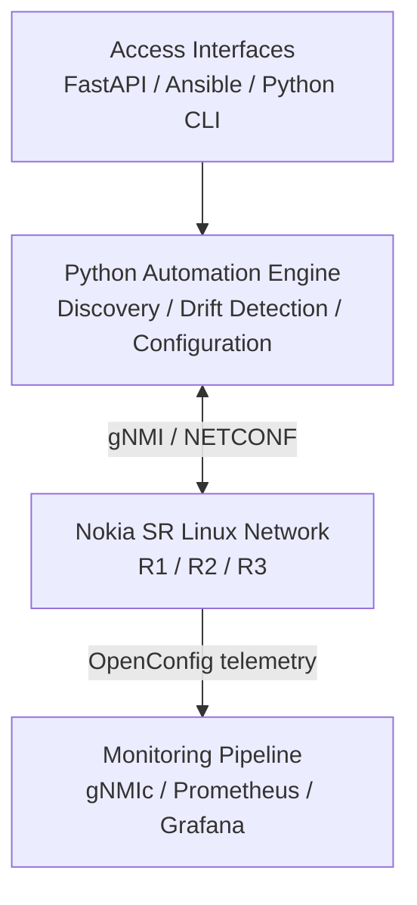

# System Architecture

## 1. Overview

The Network Automation & Programmability Platform is a Python application that implements a closed-loop network automation workflow for Nokia SR Linux. It retrieves operational state, normalizes device data, compares actual state with YAML-based desired state, identifies drift, applies configuration through the model-driven NETCONF path, and verifies the result.

FastAPI and Ansible are two ways to invoke or orchestrate the Python workflow. They are interfaces around the automation logic, not sequential stages in the device-configuration process.

## 2. High-Level Architecture

The platform consists of a Python automation engine, access interfaces, a Nokia SR Linux network, and an independent monitoring pipeline.



The Python engine uses gNMI for device-state retrieval and NETCONF for model-driven configuration and read-back verification. Jinja2 provides a separate CLI configuration-rendering path.

The monitoring pipeline operates independently of the configuration workflow, collecting and visualizing telemetry from the SR Linux routers. The following sections describe the individual components and implementation details.

## 3. Main Components

The platform components are organized by their role in the automation and monitoring workflows.

| Area | Component | Responsibility |
|---|---|---|
| Access and orchestration | FastAPI | Exposes device and workflow operations through REST endpoints |
| Access and orchestration | Ansible | Invokes and orchestrates the Python workflow |
| Network automation | Python workflow | Coordinates the end-to-end automation process |
| Network automation | Inventory loader | Loads device information from YAML |
| Network automation | Endpoint resolver | Resolves runtime device management endpoints |
| Network automation | gNMI client | Retrieves operational device state |
| Network automation | State normalization | Converts device responses into a consistent application model |
| Network automation | Desired-state loader | Loads intended network configuration from YAML |
| Network automation | Comparator | Identifies differences between desired and actual state |
| Network automation | NETCONF renderer and applier | Prepares and applies model-driven configuration |
| Network automation | Jinja2 renderer | Generates SR Linux CLI configuration files |
| Network automation | Reporting | Summarizes validation and drift results |
| Monitoring and observability | gNMIc collector | Subscribes to OpenConfig telemetry and exports Prometheus metrics |
| Monitoring and observability | Prometheus | Scrapes and stores time-series metrics |
| Monitoring and observability | Grafana | Visualizes interface traffic and operational status |

## 4. Normalized Internal Data Model

The normalization layer separates device-specific gNMI/YANG responses from application logic. The device-state processing flow is:

```text
SR Linux Device
      |
      v
   gNMI / YANG
      |
      v
Device-specific response
      |
      v
 Parser / Adapter
      |
      v
Normalized Application Model
      |
      +----> Desired-state comparison
      +----> Drift detection
      +----> Reporting
      +----> API response
```

Examples of normalized fields include interface name, administrative state, operational state, IPv4 address, route attributes, and OSPF neighbor information. The normalized model allows comparison and reporting code to work with stable application structures rather than raw device responses.

## 5. Configuration Paths

The platform supports two distinct configuration workflows: Jinja2-based CLI configuration generation and live model-driven configuration using NETCONF/YANG.

### Jinja2 CLI Configuration Generation

```text
Desired Configuration
        |
        v
Jinja2 Template
        |
        v
Generated SR Linux CLI File
```

The Jinja2 renderer generates SR Linux CLI configuration files under the `generated/` directory. This provides a separate configuration-rendering capability and does not represent the primary live NETCONF deployment workflow.

### NETCONF/YANG Live Configuration

```text
Desired Configuration
        |
        v
NETCONF Configuration Rendering
        |
        v
NETCONF edit-config / commit
        |
        v
SR Linux Device
        |
        v
Configuration Read-back
        |
        v
Verification
```

NETCONF/YANG is the primary model-driven mechanism for applying configuration to live SR Linux devices. After configuration is applied, the platform retrieves the resulting configuration state and performs read-back verification.
## 6. Runtime, Lab, and CI Separation

- **Containerlab** provides the primary three-router SR Linux environment.
- **Docker** packages the Python automation application. The application container and the Containerlab devices have separate responsibilities.
- **GitHub Actions** provisions the lab for CI, waits for OSPF readiness, runs tests, builds the application image, stops the lab, and uploads test-result artifacts.

The expanded topology with Linux endpoints belongs to the `network-test-validation-platform` validation environment. See [Network Topology](network-topology.md).

## 7. Routing Configuration Scope

### Lab Routing

- **OSPF:** Provides internal routing across the three-router topology and is used by CI to verify network readiness.
- **eBGP:** Runs as a full mesh between all three routers. All six BGP peer sessions and BGP route exchange have been verified through the live SR Linux CLI.

### Python Automation Coverage

The Python application supports BGP desired-state configuration, NETCONF configuration deployment, read-back, and configuration validation.

**Current limitation:** The application does not yet automate operational BGP peer-state or route-table assertions.

See [Routing Protocols: OSPF and BGP](routing-protocols.md) for protocol configuration, verification evidence, and implementation boundaries.

## 8. Streaming Telemetry and Monitoring

The platform includes an independent streaming telemetry pipeline that monitors all three routers in the primary Containerlab topology. Unlike the Python automation workflow, which retrieves device state on demand, this pipeline continuously collects telemetry for monitoring and visualization.

### Monitoring Pipeline

The telemetry collection and visualization flow is:

**SR Linux R1, R2, R3** → **gNMIc** → **Prometheus** → **Grafana**

- **gNMIc:** Connects to the three routers over secure gNMI (TCP `57400`), uses OpenConfig STREAM subscriptions with SAMPLE mode and a five-second sampling interval, validates certificates using the configured CA, and exports Prometheus metrics at `:9804/metrics`.
- **Prometheus:** Scrapes the gNMIc metrics endpoint every 15 seconds and stores time-series data.
- **Grafana:** Uses Prometheus as its data source for telemetry visualization.

### Monitoring Configuration

The monitoring configuration is maintained separately from the Python application:

- `telemetry/gnmic.yaml` defines gNMI targets, TLS certificate validation, subscriptions, sampling interval, and Prometheus output.
- `telemetry/prometheus.yml` defines the Prometheus scrape configuration.

### Verified Telemetry Scope

The implemented OpenConfig subscriptions monitor `ethernet-1/1` on each of the three routers. The two verified telemetry paths are:

- **Incoming octets:** `openconfig:/interfaces/interface[name=ethernet-1/1]/state/counters/in-octets`
- **Operational status:** `openconfig:/interfaces/interface[name=ethernet-1/1]/state/oper-status`

gNMI credentials are supplied through environment variables.

Only these listed telemetry paths have been verified against all three routers. Model advertisement through gNMI Capabilities does not, by itself, establish that every advertised model path is supported or tested.

### Grafana Dashboard

The `SR Linux Streaming Telemetry` dashboard contains three panels:

1. **Incoming Traffic:** Displays incoming traffic rates for R1, R2, and R3 using the rate of change of incoming-octet counters.
2. **Cumulative Incoming Octets:** Displays cumulative incoming-octet counters for all three routers.
3. **Interface Operational Status:** Displays the operational status of `ethernet-1/1` on each router.

### Relationship with the Automation Workflow

Streaming telemetry is an observability capability. It does not replace or modify the Python gNMI discovery client, desired-state comparison, drift detection, NETCONF configuration workflow, or post-change verification.

The two workflows use gNMI for different purposes:

- **Python automation:** Retrieves device state on demand for application-level discovery, comparison, and configuration management.
- **gNMIc monitoring:** Maintains streaming OpenConfig subscriptions and exports metrics for Prometheus and Grafana.
